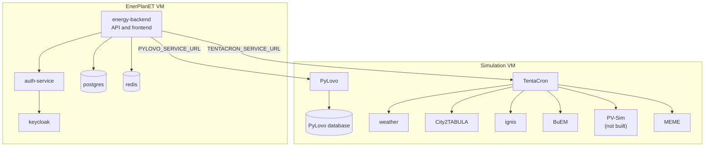

# Deployment

This page covers deploying EnerPlanET to the test server from the
`feature/heat-integration` branch, and what has to be ready before the same
setup goes to production. Setting up a single machine, local or server, is in
[Installation](installation.md).

!!! warning "Draft"
    This page describes the target deployment and the gaps to it. The
    workflow changes listed under [Changes to the workflow](#changes-to-the-workflow)
    are not made yet.

## Where everything runs

EnerPlanET and the simulation services run on separate virtual machines. The
diagram shows which machine runs what and which connections cross between them.

Only TentaCron and PyLovo are reachable from the EnerPlanET VM. The services
behind TentaCron are reached through it alone. The platform-core `webservice`
is not part of this deployment.

## Deployment readiness

One row per component. A component is ready for production when its artifact
is a published image pinned by tag, its publishing is gated on its own tests,
its serving containers restart on their own after a failure or a reboot
(`restart: unless-stopped` in its compose file), and it is stable. Production
deployment starts when every row is ready.

### What each column means:

| Column | Meaning |
|---|---|
| Component | One service, or one capability of the platform such as data or heat in simulations |
| Artifact today | What the server runs now and where it comes from: a ready-made image downloaded from a registry ("pulled"), or code compiled on the server itself ("built") |
| Target artifact | What the server should run instead: normally one ready-made image, published by the component's own repository and pinned to an exact version in `repos.conf` |
| Tests gate publishing | Whether the component's repository runs its tests before it publishes an image, so that a version with failing tests is never published |
| Test server | Whether the component can run on the test server today |
| Production | Whether the component meets the production rule above |
| Blocking | What has to happen before the component is ready, with the issue that tracks it where one exists |

#### The status values in the Test server and Production columns:

| Value | Meaning |
|---|---|
| ready | Meets the requirement for that environment |
| builds | Runs, but from code compiled on the server; allowed on the test server, not in production |
| partial | Works in a reduced form, for example flat demand instead of hourly profiles |
| not ready | Does not meet the requirement yet; see Blocking |
| missing | Does not exist yet |

---

### The current status of components:

| Component | Artifact today | Target artifact | Tests gate publishing | Test server | Production | Blocking |
|---|---|---|---|---|---|---|
| postgres, redis, keycloak | pulled image, pinned | same | upstream | ready | ready | none |
| auth-service | built on the server from source | published image | no CI | builds | not ready | publishing workflow for platform-core, no issue yet |
| energy-backend (API and frontend) | built on the server, environment URLs baked into the frontend build | one published image, URLs read at runtime | integration workflow tests the branch, not a published image | builds | not ready | publishing workflow; runtime frontend configuration; no issue yet |
| PyLovo | built from a pinned commit | published image | unknown | builds | not ready | PyLovo image publishing; image size (21 GB) |
| TentaCron | built from a pinned commit | published image, pinned | yes | builds | not ready | TentaCron release with the EnerPlanET integration; restart policy on the `tentacron` service |
| MEME | built from source | published image | unknown | builds | not ready | MEME image publishing and a restart policy on `api`, by its maintainer |
| BuEM | pulled image, pinned | same | yes | ready | not ready | restart policy on `buem-gateway` and `buem-model` |
| ignis | pulled image, pinned | same | yes | ready | not ready | restart policy on `ignis` and `db` |
| City2TABULA | pulled image, pinned | same | yes | ready | not ready | restart policy on `city2tabula` and `city2tabula-db` |
| weather | pulled image, pinned | same | unknown | ready | not ready | confirm publishing waits for tests |
| PV-Sim | does not exist | published image behind TentaCron | n/a | missing | missing | PV simulation service, no issue yet |
| Data | committed fixtures for Bremen, Brno, Loenen, Vienna | fixtures for the test server; data pipeline for production | n/a | ready | not ready | data pipeline for new sites, not started |
| Heat in simulations | Calliope gets flat electricity per building and no heat | BuEM heat and electricity, heat supply technologies | n/a | partial | not ready | #118 and follow-ups |
| Simulation time step | always hourly | coarser step for large models | n/a | partial | not ready | #124 |
| Deploy workflow | manual jobs from `main`, builds on the server, deploys only the EnerPlanET VM | test-server deployment of both VMs from images | n/a | not ready | not ready | [Changes to the workflow](#changes-to-the-workflow) |

## The current workflow

`.github/workflows/deploy-production-pipeline.yml` runs on a self-hosted runner
on the EnerPlanET VM (labels `self-hosted`, `enerplanet`). A push to `main`
runs only `check-runner`; every other job is started by hand with the `step`
input.

| Job | Does |
|---|---|
| `check-runner` | Checks out the repository with submodules and LFS, and checks Docker |
| `infra-postgres-redis` | Copies the platform-core files to `$HOME/deploy` and starts postgres and redis |
| `infra-keycloak` | Starts keycloak |
| `infra-keycloak-init` | Runs keycloak-init and writes the client secrets into the services' env files |
| `platform-auth-webservice` | Builds auth-service and webservice from source on the server and starts them |
| `build-app` | Builds the `enerplanet` image on the server, with the production Keycloak URLs as build arguments |
| `deploy-app` | Writes the production env file and starts the app container |
| `migrate`, `seed` | Run the database migrations and seed |

## Changes to the workflow

1. **Target the test server from the feature branch.** Add a deployment for
   `feature/heat-integration` to the test server, with its own server URL,
   cookie domain and secrets, beside the production pipeline from `main`.
2. **Drop the webservice.** `platform-auth-webservice` builds and starts only
   auth-service.
3. **Point the backend at the simulation VM.** `deploy-app` sets
   `TENTACRON_SERVICE_URL` and `TENTACRON_API_KEY` beside the existing
   `PYLOVO_SERVICE_URL`. Without them the backend cannot reach any heat
   service.
4. **Deploy the simulation VM.** A runner on the simulation VM, or a job that
   reaches it, starts TentaCron, the services behind it and PyLovo at the
   versions pinned in `repos.conf`, and loads the fixtures.
5. **Pull images instead of building.** Each component moves from "builds" to
   a pulled image as its row in the readiness table becomes ready. Until then
   the job builds it from the pinned commit.
6. **One image for every environment.** The frontend reads its Keycloak URL,
   realm and client at runtime instead of at build time, so the image tested
   on the test server is the image deployed to production.

## Data on the test server

The test server runs on the committed fixtures only: PyLovo grids and
City2TABULA 3D data for Bremen, Brno, Loenen and Vienna, and the weather
scenarios. No data pipeline runs on it. The fixtures and their regions are
listed in [Test Data](test-data.md).
